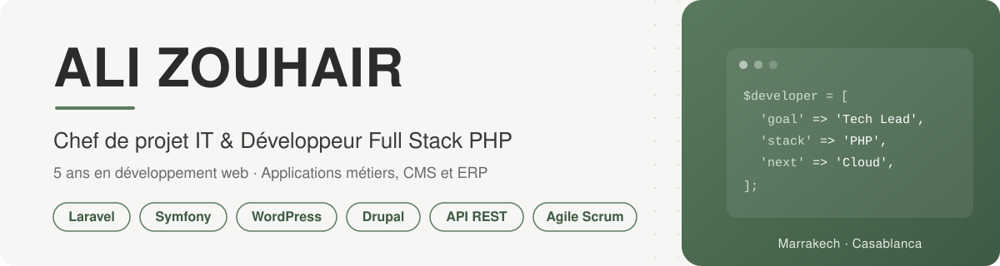

<picture>
  <source media="(prefers-color-scheme: dark)" srcset="./assets/banner-dark.svg">
  
</picture>

  
  
  
  

## Profil

Chef de projet IT et développeur full stack PHP, j'ai **5 ans d'expérience en développement web** et 3 ans en support IT. Je conçois et pilote des **applications métiers, des CMS et des ERP**, du recueil des besoins jusqu'à la mise en production, en **Agile Scrum** ou en **cycle en V**.

Mon double profil, technique et fonctionnel, me permet de faire le lien entre clients, équipes de développement et contraintes d'infrastructure. Je suis actuellement **Développeur web & Chef de projet chez Feel and Clic**, une agence web française. En parallèle, je prépare un **Master II en Big Data & Cloud Computing** à l'ENSET Mohammedia, avec un cap clair : devenir **Tech Lead**, puis **architecte logiciel**.

## Ce que j'apporte

<table>
  <tr>
    <td width="33%" valign="top">
      <h3>Développement</h3>
      <ul>
        <li>Back-end PHP orienté objet et MVC</li>
        <li>Laravel, Symfony, Zend / Laminas, CodeIgniter</li>
        <li>Conception et maintenance d'API REST</li>
        <li>Thèmes et modules sur mesure WordPress et Drupal</li>
        <li>Modules ERP : ventes, stock, logistique, RH, comptabilité</li>
      </ul>
    </td>
    <td width="33%" valign="top">
      <h3>Pilotage de projet</h3>
      <ul>
        <li>Recueil des besoins et cahier des charges</li>
        <li>Spécifications fonctionnelles et techniques</li>
        <li>Agile Scrum : sprints, rituels, user stories</li>
        <li>Planning, KPI, reporting et comités de pilotage</li>
        <li>Recette, mise en production et gestion des incidents</li>
      </ul>
    </td>
    <td width="33%" valign="top">
      <h3>Infrastructure et qualité</h3>
      <ul>
        <li>Déploiement et maintenance LAMP</li>
        <li>Linux, Apache, MySQL, Oracle</li>
        <li>Git, GitHub, GitLab, Azure DevOps</li>
        <li>Code review, tests unitaires et d'intégration</li>
        <li>Diagnostic réseau et serveurs</li>
      </ul>
    </td>
  </tr>
</table>

## Stack technique

  

**En montée en compétences** dans le cadre du Master :

  

## Parcours

| Période | Poste | Entreprise | Points clés |
| :-- | :-- | :-- | :-- |
| **2024 – aujourd'hui** | Développeur web & Chef de projet | Feel and Clic | Pilotage des projets clients de bout en bout, sites WordPress et Drupal sur mesure, infrastructure LAMP |
| **2023 – 2024** | Analyste développeur | Winfox Service / E-LMA | Back-end PHP (Zend / Laminas), API REST, équipe Scrum avec un client luxembourgeois |
| **2022 – 2023** | Analyste développeur & Chef de module ERP | Integral In Progress Technology | Chef de module sur l'ERP IPTECHONLINE : ventes, stock, RH, comptabilité, GMAO |
| **2022** | Développeur web, stage de fin d'études | Maroc Climate & Security | Sites web en PHP (CodeIgniter, Laravel) et MySQL |
| **2018 – 2022** | Référent IT | Decathlon Maroc | Référent IT de l'agglomération de Marrakech, application interne en PHP et Laravel |

## Formation

| Période | Diplôme | Établissement |
| :-- | :-- | :-- |
| **2026 – 2028** | Master II Ingénierie Informatique, Big Data & Cloud Computing (Bac+5) | ENSET Mohammedia, Université Hassan II |
| **2021 – 2022** | Licence professionnelle en génie informatique (Bac+3) | Université Privée de Marrakech |
| **2017 – 2019** | DTS en développement informatique | NTIC, Marrakech |

## Langues

**Arabe**, langue maternelle · **Français**, courant · **Anglais**, professionnel · **Allemand**, débutant

<b>English summary</b>

 

IT Project Manager and Full Stack PHP Developer with **5 years of web development experience** and 3 years in IT support. I build and lead business applications, CMS and ERP projects (Laravel, Symfony, WordPress, Drupal, REST APIs) from requirements gathering to production, using Agile Scrum or the V-model. Currently Web Developer & Project Manager at Feel and Clic, a French web agency, and pursuing a Master's degree in Big Data & Cloud Computing. My goal is to grow into a **Tech Lead** and then a **software architect** role.

---

  Ouvert aux échanges sur le développement web, la gestion de projet et le cloud · Contact : <a href="mailto:alizouhair28@gmail.com">alizouhair28@gmail.com</a>

